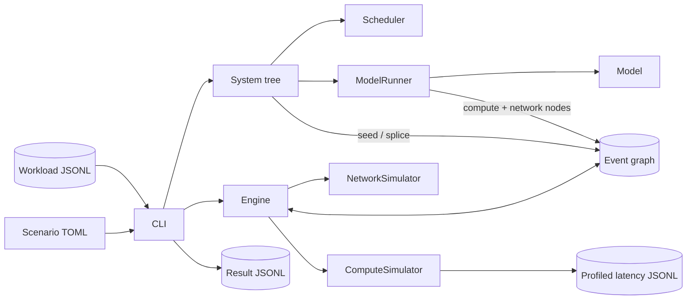

# Simthesizer Architecture

## Purpose and Current Boundary

Simthesizer is a discrete-event simulator for LLM serving. Its native input is
an agent workload: each request is a DAG of LLM calls and tool calls. Its
output is per-token timing for every LLM call, in the same DAG shape.

The implemented product is a Rust CLI that reads one scenario config and one
canonical workload JSONL and writes one result JSONL. Compute cost comes from
per-layer latency tables profiled with vLLM on real hardware; communication
cost comes from a flow-level network model. `scripts/baseline.py` replays
single-call workloads on vLLM for comparison. `scripts/compare.py` measures
serving-metric errors; `scripts/draw.py` plots latency and throughput.

This document is the repository-wide architectural source of truth.
Component-level detail lives under [`architectures/`](architectures/).

## Drivers

- Agent workloads are first class: dependencies, think time, and tool-call gaps
  are simulated, not flattened into independent requests.
- Every cost comes from a mechanism (a scheduling decision, a cache lookup, a
  profiled kernel, a contended link), never from a tuned factor or hit rate.
- Wrong parameters are the dominant error source, so hardware, model, and
  serving parameters are explicit in the scenario config.
- Adding a component is a self-contained change with no central list to edit.
- A run is deterministic: equal config and workload give identical results.
- A fresh clone runs every scenario under `examples/` without a GPU or external artifact.
- Accuracy is measured against real runs, not asserted.

## Current System



The engine owns virtual time and nothing else. Systems, runners, and simulators
own all serving semantics and reach the engine only through graph nodes.

## Component Boundaries

- `simthesizer-cli` owns filesystem IO: config and workload parsing, the path
  resolution root, and result writing. It holds no simulation semantics.
- The engine owns the event graph, ordering, and time. Node payloads are opaque
  to it; see [event engine](architectures/engine.md).
- A `System` owns request lifecycle: seeding request DAGs, splicing in work,
  completion accounting, and composition into multi-instance and disaggregated
  topologies; see [serving systems](architectures/systems.md).
- A `Scheduler` owns ready LLM work, batch admission, KV memory, and its
  prefix cache. A `Router` owns whole-request placement; see
  [scheduling](architectures/scheduling.md).
- A `Model` owns the layer plan and memory footprint for a parallel strategy.
  A `ModelRunner` owns one parallelism axis and expands a batch into compute
  and network nodes, including collectives; see
  [model execution](architectures/execution.md).
- A `ComputeSimulator` prices one layer for one batch. A `NetworkSimulator`
  prices point-to-point transfers over a topology; see
  [cost models](architectures/cost-models.md).
- An exclusive-resource Rooflang runner uses bundled source to price whole Llama
  iterations from Rust or Python model definitions, without profiling tables;
  see [Rooflang integration](architectures/rooflang.md).
- `scripts/profile.py` measures vLLM components and preserves exact batch shapes
  in JSONL; see [profiling](architectures/profiling.md).
- `scripts/baseline.py` replays single-call workloads and records client-visible
  token timings; see [validation](architectures/validation.md).
- `scripts/results.py` owns result validation, DAG timing reconstruction, and
  serving metrics shared by comparison and plotting. Analysis never enters the
  simulation path; see [validation](architectures/validation.md).
- Components expose read-only state; the engine supplies observation times and
  the CLI writes optional JSONL traces. See [observability](architectures/observability.md).

Detailed contracts:

- [Event engine](architectures/engine.md)
- [Workload and results](architectures/workload.md)
- [Configuration and registries](architectures/configuration.md)
- [Serving systems](architectures/systems.md)
- [Scheduling](architectures/scheduling.md)
- [Model execution](architectures/execution.md)
- [Cost models](architectures/cost-models.md)
- [Profiling](architectures/profiling.md)
- [Validation](architectures/validation.md)
- [Observability](architectures/observability.md)
- [Agent workflow](architectures/agent-workflow.md)

## Simulation Flow

1. The CLI deserializes the scenario into a tree of components, resolves
   relative paths once, and initializes the tree top-down.
2. It validates each workload row and hands it to the root system, which seeds
   that request's DAG into the graph, released at its arrival time.
3. The engine runs ready nodes in (time, node ID) order until the graph drains.
4. A logical node calls back into its owner, which may add nodes or rewire the
   running node's outgoing edges. Compute and network nodes ask their simulator
   for a latency.
5. Systems hand over finished requests; the CLI writes them by request ID.

Every workload request is seeded before the engine starts. Routing runs at
the simulated arrival, after any parent dependency, using current instance
loads. Routed children enter the graph beneath that arrival event.

## Data Contracts

- Workload JSONL is the only input format: one request DAG per row. Each LLM
  sub-request carries its own full context; runtime never reconstructs context
  from predecessors.
- Result JSONL repeats the input DAG and adds one `token_latency` array per LLM
  sub-request: TTFT first, then inter-token latencies.
- A scenario is one TOML tree whose `kind` fields select registered
  implementations.
- A profile holds per-component latency samples for one model on one machine.
  JSONL preserves request shapes and measurement samples. Scenario mappings join
  model layer names to profile component names.

## Determinism and Failure

- Simultaneous nodes run in creation order. Sampled MoE routing uses a fixed
  seed. Nothing on the simulation path reads the wall clock.
- Any inconsistency (unexpected payload, duplicate completion, unadmittable
  request, leftover nodes, unfinished requests) aborts the run. A partial
  result is never written.
- Execution is single-threaded. Graph nodes reference their owners by pointer,
  which is sound only because owners live in the boxed config tree, unmoved
  after initialization.

## Repository Shape

```text
crates/simthesizer-core/   engine, component traits, registries, built-ins
crates/simthesizer-cli/    `simthesizer` binary: config, workload, result IO
scripts/profile.py        standalone vLLM component profiler
scripts/baseline.py       standalone vLLM workload replay
scripts/results.py        shared result analysis
scripts/compare.py        serving-metric error reports
scripts/draw.py           latency and throughput figures
tools/                    agent workflow and validation tools
pyproject.toml           Python dependencies and dependency groups
uv.lock                  locked Python dependency versions
devenv.nix               Rust, Python/uv, and CUDA environments
examples/profiles/        profiling receipts
examples/data/<device>/   profiles grouped by GPU model
examples/scenarios/       named simulator and baseline configurations
examples/workloads/       canonical workload JSONL
architectures/             component architecture documents
.agents/skills/            agent skills shipped with the repository
```

`simthesizer-core` depends on no IO beyond loading profiles at
initialization. The CLI depends on the core, never the reverse.

`scripts/` contains commands for human use; `tools/` contains agent-facing tools.

## Evolution Rules

- Add a component by implementing its trait and registering a `kind`. Never
  add a closed match over implementations.
- New runtime work enters as graph nodes. No component advances time itself.
- A new parallelism axis is a new runner; collectives stay point-to-point
  transfers joined by barriers.
- A new cost needs a mechanism or an explicit config knob. Propose any proxy
  before implementing it.
- A new model gets its own implementation and its own profile on the target
  hardware; never alias a similar model.
- Change the workload or result schema together with its Rust types, Python
  IO, bundled workloads, and the workload document.
- Architecture-affecting changes update this document and the relevant
  component document in the same change.
