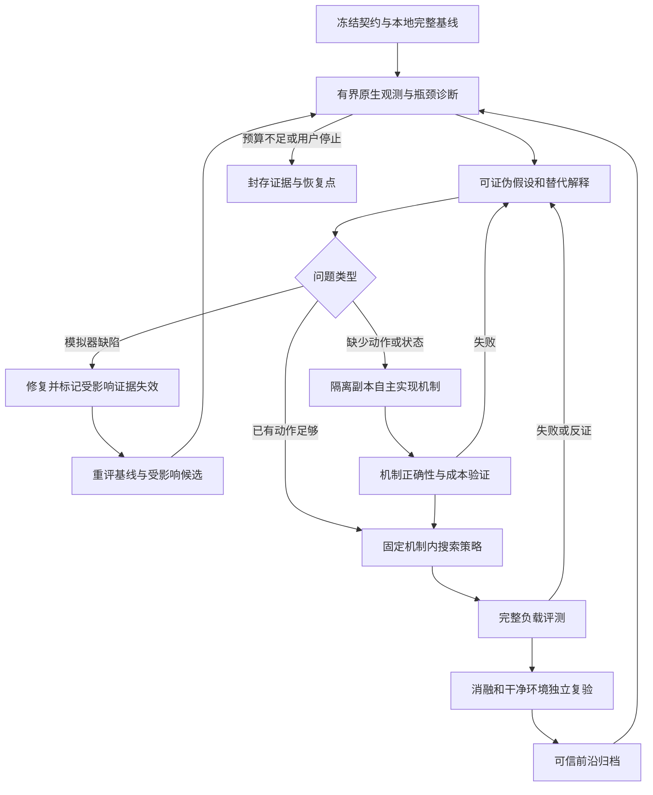
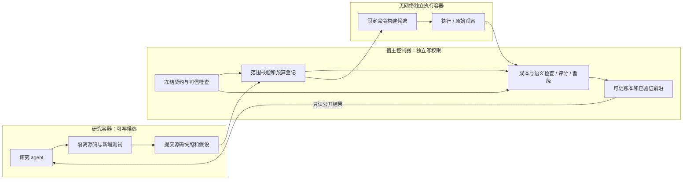
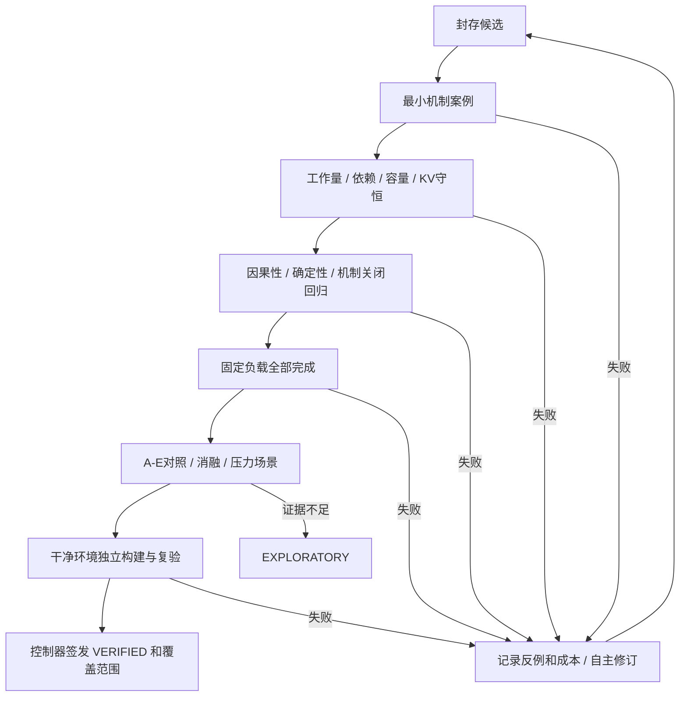

# Qwen MoE 瓶颈驱动自主优化

状态：已有跨模块机制与策略搜索入口，操作见 [SEARCH.md](SEARCH.md)，实际 agent 指令见 [SEARCH_TASK.md](SEARCH_TASK.md)，新增契约见 [CROSS_MODULE.md](CROSS_MODULE.md)。Rust/Python 实现区默认开放，包括引擎、资源和公共接口；固定事实、评分、输入、工具和依赖受保护。机制提交须附封存证据与结构化 plan，宿主按差异选择检查，并汇总对照/重放/全案例的待审清单，始终保留 `EXPLORATORY`。本文保留 [task.md](../../task.md) 的长期设计；严格 oracle、独立机制语义证明和任意机制的 `VERIFIED` 晋级仍未实现。本轮仅做静态与 mock 检查，尚未运行真实 Docker、构建、仿真或搜索。

用户提供的《推理的计算与数据搬运》作为完整冻结参考，见 [33 页文本](references/compute-data-movement.txt) 与[页码映射](references/compute-data-movement.md)。用于生成与反驳假设，不替代当前基线证据，也不限定创新范围。

## 1. 目标与验收

在冻结模型语义、物理资源、请求工作量和评分口径下，自主发现瓶颈，开发必要的新机制，再搜索其策略。每条请求完整完成，提高满足 TTFT/TPOT 目标的输出吞吐/GPU，保存延迟—吞吐 Pareto 候选。机制数量、代码量和单个最好分数都不是研究成绩。

内层在一个机制版本内优化策略；外层可以改变建图、放置、通信组织、调度接口和资源生命周期。遇到接口不足，系统应提交源码实现及验证证据，而非永久停留在人工开发建议。

| 要求 / task.md 来源 | 验收位置与证据 |
|---|---|
| R1 / 一、二：依据当前代码建立事实 | IMPLEMENTATION 第 1–3 节；源码符号、已有测试与产物，区别已有能力和待开发能力 |
| R2 / 三：双层闭环可恢复 | 本文第 3 节；状态、转换守卫、输入输出、失败和预算规则 |
| R3 / 四：瓶颈驱动，允许补观察 | 第 4 节；假设卡、替代解释、低开销原生信号、区分实验 |
| R4 / 五：扩展机制但保留语义 | 第 5 节及 IMPLEMENTATION；唯一放置状态、固定专家选择、因果性 |
| R5 / 六、七：可信评测及自主晋级 | 第 6–7 节；不可自写 VERIFIED、独立检查、验证器扩展门禁 |
| R6 / 八：真实权限 | 第 8 节和 LAUNCHER；进程与挂载边界，不以角色名冒充隔离 |
| R7 / 九：公平实验 | 第 2、9 节；A–E 对照、完整工作量、身份、数据切分、独立复验 |
| R8 / 十：复用工程与基线 | 第 10 节和 LAUNCHER；身份匹配、时间目录、恢复、只清理自有资源 |
| R9 / 十：预算与观测成本 | 第 4、10 节；服务性能、仿真成本、研究成本分别核算 |
| R10 / 十一：可实施交付 | 五个文档一致；草案字段和未来接口明确标注；本轮仅静态审阅 |

验收的最小成功案例：agent 从原生证据识别组内放置瓶颈，证明既有 route/batch/KV 策略不足，自主实现持久 Attention 组放置，完成独立检查、完整负载和消融，解释收益或失败，并提出有证据的下一项需求。不要求每轮必须提升；不能验证的收益不得晋级。

## 2. 固定实验与指标

首阶段沿用 shared Qwen3-235B-A22B、单 LLM 请求的 P/D 契约。现有支持的并行组合及容量限制见 IMPLEMENTATION；不把一个示例硬件部署当全部支持范围。具体 GPU、SLO、负载倍率、运行预算由后续冻结配置确定，本设计不将 Llama 的初始 SLO 自动移植为 Qwen 生产目标。

评分沿用可信 [results.py](../../scripts/results.py) 的 `validate_complete`、`measurements`、`slo_metrics`、`summarize_run`：

- TTFT：每请求首 token 延迟。TPOT：该请求后续 token 延迟的均值，不是所有 ITL 的全局均值。
- 达标请求同时满足 TTFT 和 TPOT 上限；单输出 token 没有 TPOT，不能填零。零输出请求不进 SLO 分母，但必须完成，其尾部计入总服务时长。
- 令 `T = 原生服务结束时刻 − 最早请求到达时刻`，`G = 唯一物理 GPU 数`，`S = 达标请求集合`：`goodput/GPU = Σ(i∈S) output_tokens[i] / T / G`。
- `joint_pass_fraction = 达标请求数 / 有输出请求数`；达到冻结比例才进入可行前沿。保留不可行结果用于诊断，不混入有效前沿。
- Pareto 目标为最小 TTFT p99、最小 TPOT p99、最大 goodput/GPU；全为单 token 的 case 去掉不可用 TPOT 维度。不把三者任意加权成单一分数。

示例推导仅解释单位：4 张 GPU、完整服务 2 秒，达标请求共输出 120 token，则为 15 token/s/GPU；其余不达标请求的时间仍在分母内。不是性能预测。

总吞吐、tokens/s/user、tokens/s/GPU、ITL 和其他尾延迟继续保存。`metrics.png`、`throughput.png` 默认保留；前沿至少给出 TTFT/TPOT 与 goodput/GPU 的对应图及精确坐标。完整请求排除通过丢弃慢请求、缩短输出、截断运行获得的虚假提升。

## 3. 两层闭环与状态

固定程序持有 append-only 账本。研究者提交假设/源码；研究者写的状态只是笔记。每次尝试绑定不可变快照，修复创建新 revision，原失败记录不覆盖。

| 状态 | 输入与准入 | 权威输出与下一步 |
|---|---|---|
| `DRAFT` | 假设卡、原生证据、候选 patch、父版本、预期检查 | 控制器检查范围/预算，封存源码；证据不足补诊断 |
| `CHECKING` | 已封存源码、固定契约、可信检查集 | 构建、最小机制案例、不变量、成本/因果/关闭回归；通过才进入评测 |
| `EVALUATING` | 检查通过；明确完整 case 列表 | 控制器保留每 case 的完整结果、状态与评分；筛选点标明未覆盖矩阵 |
| `REPLAYING` | 要求的完整矩阵、A–E 消融和解释已齐 | 无共享可写缓存的独立构建/重放；同一候选同 case 结果应逐字节一致 |
| `VERIFIED` | 全部守卫通过；独立复验覆盖明确 | 控制器写不可由 agent 改写的 receipt；仅可行、非支配点进入已验证前沿 |
| `FAILED` | 反例、超时、OOM、构建错误、校验失败或缺失数据 | 保存日志和已耗预算；自主修复/缩小候选/淘汰；新尝试有新身份 |
| `EXPLORATORY` | 可运行，但关键模型假设或检查能力不足 | 可继续研究，不能作为已验证收益或前沿；补齐独立验证后重新晋级 |

研究运行另有 `ACTIVE/STOPPED/FINISHED` 生命周期，不重复发明候选状态。`STOPPED` 保留未完成尝试；恢复时先核对身份、回收本次拥有的残留任务，未有完成 receipt 的尝试计费并重开，不能拿部分结果评分。达到预算、用户停止、不可恢复基础设施故障时封存。连续失败可停止一个假设，但不据此宣称搜索空间耗尽。

## 4. 诊断决定机制

每份假设卡至少包含：case/路由身份、证据时间窗、实例/组/rank/层/资源、观察值与单位、当前实现原因、替代解释、拟改决策或依赖、目标指标、额外计算/传输/内存/控制开销、风险及瓶颈转移、最小区分实验、失败判据、局部停止条件、父候选和实验预算。

| 症状 | 需要的原生证据 | 必须排除的解释 / 触发方向 |
|---|---|---|
| 排队、TTFT 尾部 | 到达/接纳/首轮开始的独立时间与队列龄 | 容量受限、P 已满或 KV 等待；先用既有路由/分块策略作对照 |
| Attention 组不平衡 | 当前绑定、每组队列与已完成服务量、容量 | 专家或全实例 barrier 主导；触发持久组放置 |
| 专家热点 | 已揭示 token→expert 数、每 rank 就绪/完成量 | Attention 放置、通信拖尾；触发任务顺序或有界聚合 |
| dispatch/combine 拖尾 | 有来源的字节数、就绪/提交/完成时刻、方向链路 | HBM 而非 fabric、启动频繁；触发分块/提交顺序/窗口 |
| 同步等待 | 实际已就绪工作和阻挡依赖、相应完成边 | 算子确需全部输入；仅可用真实细粒度依赖替换 barrier |
| HBM 压力 | demand 分量、实际服务进度、读写与形状 | 计算饱和或 workspace 约束；触发合法复用/融合 |
| 容量拒绝 | 驻留权重、KV、临时分配、拒绝原因与释放事件 | `known_trace` 预留假设；先区分容量和带宽 |
| P/D KV 等待 | produce/send/ACK/read-ready 与具体 token/head 区间 | 已登记的未来层读取不等于当前 stall；触发 locality/交接协调 |
| EP 与 KV 争用 | 相同物理有向链路的重叠活动、速率变化 | 端点 HBM、独立不相交链路；触发联合并发控制 |

优先复用 `EnvironmentObservation` 和有界决策采样；欠缺的队列分段、实际阻塞原因、路由揭示统计再在 owner 处增加。默认计数器/在线聚合/固定大小样本，关闭路径不分配逐事件记录。记录采样区间和丢弃数量；缺失不当零。详细 trace 仅指定实例/轮次/层/时间窗，受字节和墙钟上限约束。

剩余服务需求不是 GPU 利用率；已登记 KV 读取不是当前关键路径。并发阶段的服务时间不可直接相加解释 E2E：用事件因果边和时间区间；需要归因时用配对消融，重叠部分单独呈现。观察开关应产生相同仿真结果，并测量其墙钟/RSS 增量；未测开销不能称低开销已验证。

## 5. 首机制和后续候选

推荐先实现**请求到副本内 Attention 组的持久放置**。现有实例选择无法改变组选择，多处取模又让计算和 KV 容易失配。这个机制范围小，可用两组负载偏斜和 P/D KV 不同落点构造反例；它只是优先假设，必须先有组压力证据才能宣称适合目标负载。

拟议状态由 `KvRuntime::plans[request_id]` 的 `Plan` 唯一持有：P、D 各一份 `{instance, group}`，ranks/设备清单从冻结拓扑派生为只读视图；无 decode 工作时 D 放置为空。PD 在到达决策校验后原子建立；runner/worker、KV 头分片、EP 来源与 P/D 复制读取相同记录。策略只提交选择，不另存第二份权威映射。首版生命周期内不迁移；最后阶段完成且无引用/传输/读取条件后释放。参考动作恢复原来的取模选择，便于关闭回归。

P/D 可有不同 TP/EP，组内必须完整覆盖各自 KV 头；不得让两处请求同时持有不一致的组视图。兼容旧协议须在入口规范化一次，Qwen 计算与 KV 层禁止各自回退取模。详细设计和区分案例见 IMPLEMENTATION。

| 次序 | 候选 | 前置条件与证据门槛 |
|---|---|---|
| 0 | 既有 batch/分块/等待/KV 窗口/副本路由 | 先获得旧机制最优努力对照 B，确定不是现有策略就能解决 |
| 1 | 持久组放置及 KV locality | 原生组压力有差异；单一映射能解释计算与 KV 路径；先固定不迁移 |
| 2 | dispatch/combine 分块与专家就绪推进 | 真实输入覆盖可验证、缓冲生命周期完整；等待和链路重叠证据足够 |
| 3 | 有界聚合、通信计算流水、EP/KV 协调 | 分块启动/同步成本已计入；压力对照排除单纯吞吐让步 |
| 4 | 专家放置/复制/迁移及缓存 | 热点持续性超过搬运成本；权重/激活驻留、传输、一致性、回收可独立核查 |

这不是封闭动作清单。agent 可提出其他必要能力，但每个新动作必须有观察、状态、执行、成本和验证落点。

**专家选择属于模型工作量。** 固定 `(request, token position, layer)` 的有序 top-k，不能调种子、减少专家或换成便宜专家。均匀合成、偏斜合成、真实路由回放是三个明确的输入模式；当前只有均匀运行和测试注入，偏斜/回放的统一运行协议待实现。真实负载的请求长度不代表真实专家分布。

worker 预先生成整轮图不代表策略可以预知后续层路由。未来实现须把路由真值留在可信 oracle，按对应 router/top-k 完成事件揭示，placement 只看已到达请求、当前状态和已完成历史。运行时策略不得读取文件、未来请求、真值 seed 或未揭示路由；全图内部数据不得直接穿透观察接口。

公开 seed=0 和已见训练 trace 不能提供隐藏未来的保证：保留为回归/训练，并加“相同可见前缀、不同隐藏未来”的配对检查。需要盲评时另冻结私有路由输入，A–E 全部重评，不能事后把已公开输入改称 holdout。任意源码的因果性无法仅靠字段隐藏证明；需受限观察接口、代码审查与干预检查，不能宣称已有形式化证明。现有 `known_trace` 容量预留保留并标注，隐藏输出长度字段不能消除这个先验。

## 6. 候选空间与可信边界

候选可跨隔离副本的 Rust/Python 实现区改造引擎、事件图、资源仲裁、公共接口、建图、runner、policy/scheduler、P/D 及 KV，并自行增加模块；不能直接改宿主源码。基础模型维度、专家选择、硬件容量/带宽/基础定价、输入、评分器、冻结外部检查、控制器和依赖不可修改。时间推进实现可改，时间单调、因果依赖及工作守恒仍须成立。机制与固定事实混合的模块由静态保护锁定事实片段，配合独立检查；不是重新列一份封闭机制白名单。

候选可提出更精确的依赖、复用、融合或生命周期机制，不把 core 永久只读。但成本计算仍由冻结公式重算；`Work` 中自行填写的更低数字不是证明。新增 buffer、重叠分配、启动、同步、读写、迁移/复制和回收均须有成本归属。调度 CPU 当前为零模拟时间；新控制操作需声明其建模边界和敏感性，改变基础假设则另立契约并重评。

**外部评分不等于语义可信。** 相同候选重放只能说明可复现，不能发现它稳定地漏算工作。长期目标是从独立规范重建请求/token/layer/top-k、张量、读写、传输、依赖和容量义务，再按冻结 oracle 核验。当前宿主从实际改动推导检查义务，执行冻结外部回归及公共资源 fixture，要求 plan 为每项义务给出论证和测试。agent 可直接改造引擎和资源机制，无需逐模块人工批准；现有检查不足以覆盖的新语义仍是探索结果。不能直接信候选自报的 trace、完成数或 capability。

默认搜索保留流式义务摘要及有界异常证据，不要求全量历史；检查时独立重算摘要，不能只比较候选自己生成的两个摘要。小机制案例保留完整 trace 供逐边核查，目标全负载采用流式守恒检查与必要的定向追踪。

未知机制可能超出既有验证器：研究者可自主提交独立的“验证扩展”patch，由验证角色在独立环境审阅，固定程序跑旧可信检查、故意漏算/重复释放/早读/未来泄漏等反例和变形测试。通过后控制器登记新的 `validation_id`，不覆盖旧检查；相关候选必须重新验证。旧检查删除、豁免、阈值放宽或评分口径改变不属于自动扩展。不能检查的关键假设留在 `EXPLORATORY`；不能用模型说“通过”代替检查。只有目标、语义、资源预算、验收口径或未经授权投入改变才需要人工决定。

## 7. 晋级链与失败反例

机制关闭时与冻结基线逐 token/必要 trace 对照；机制开启后合法改变调度时间，不能再要求与旧版延迟相同，但工作量和完整性不变量必须相同。同一新候选的独立复验要求确定性结果一致。容量不足应等待或报明确错误，不能消失请求；暂不可就绪的 token/head 不得因区间合并跨过缺口。

删 barrier 的候选必须证明消费者所有真实输入已经产生，缓冲区在最后消费者和发送 ACK 后释放。故意去掉一条必要边、一个专家、一次 HBM 读或一个引用的变异版本须被可信检查拒绝。反例拒绝、重放一致、既有解析模型下收益，分别只是对应层次的证据；均不证明实际 GPU/NCCL 时间准确。

缺陷修复另列 `kind=simulator_fix`，记录影响范围，失效并重跑受影响基线及候选；不把成本漏算修复算成机制创新。无法确定影响范围时重评整个可比矩阵，旧证据保留但不参与晋级。

## 8. 最小角色分工

| 角色 / 程序 | 可读 | 可写与输出 | 无权执行 |
|---|---|---|---|
| 研究 agent（诊断、设计、实现、策略搜索） | 可见训练/验证、只读基线和已公开 receipts、源码副本 | 候选机制/策略、新增测试、假设与研究记录、提交请求 | 改评分契约、直接写可信状态、访问 holdout/凭据、控制宿主 Docker |
| 独立验证 agent | 封存候选、冻结契约、检查结果；无研究容器共享写目录 | 单独审查意见、反例建议、独立验证扩展提案 | 改候选快照、改分数、单独签发 VERIFIED |
| 宿主可信控制器（固定程序） | 契约、封存源码、原始结果和私有检查材料 | 快照、预算、固定构建/执行任务、权威评分、状态/归档、验证版本登记 | 接受任意 shell 文本、以 agent 自报分数晋级 |

常规策略可复用已有验证集，不必每次调用第二个 agent；新机制或验证扩展才需要独立审阅。证据冲突按固定反例/检查结果处理，新增区分实验，不投票；未解释冲突不得晋级。两个 agent 若共用可写容器只能叫协作审查。部署级目录、UID、网络、权限与提交协议见 LAUNCHER。

## 9. 对照、身份与数据切分

每个主要机制至少包含：A 当前 Qwen 基线；B 旧机制+优化策略；C 新机制+参考策略；D 新机制+优化策略；E 从 D 移除关键组件的版本。C 的参考策略要明确，如仅新放置动作使用确定的负载规则，其余仍 FCFS；A/B/C/D/E 使用同 case、路由、资源和成本。

对某一相同评分量 `g`，报告 `C−A`、`B−A`、`D−C`、`D−B`，同时报告尾延迟、达标率、回退 case。B/D 分别搜索后的差值混有策略差异及搜索效果，不能直接叫纯机制×策略交互。需要交互归因时，另做固定的 2×2 对照：旧/新机制分别执行语义与参数一致的参考策略 S0 和兼容策略 S1；此时 `g(M1,S1)−g(M1,S0)−g(M0,S1)+g(M0,S0)` 才是这两个固定因素的交互项。新动作无法在旧机制表达时明确此限制，不伪造对应动作。

不能只在赢家负载展示。E 须保留正确性；删除必要工作不算消融。B/D 搜索效率采用相同预声明研究预算，计入诊断、开发、失败、构建、评测、验证与 agent 调用。

拟议身份（均由控制器计算）：

- `contract_id`：工作负载/变换规则/切分、模型语义、路由输入与揭示协议、硬件、基础成本、SLO、指标、必需验证义务和晋级规则。
- `mechanism_id`：完整 base 清单、允许 patch 的内容和模式、入口/接口版本、机制配置。`policy_id`：策略源码及参数。保留完整源码清单，不能只记 Git HEAD。
- `case_id`：原始与派生负载、倍率、split、路由模式/种子或私有承诺；到达倍率只改到达间隔，不改内容/输出。
- `trial_id`：contract、mechanism、policy、case、成本实现、验证实现、镜像/依赖/编译器身份；每次重试另有 attempt，不丢失败预算。

同一 contract/case 下机制可不同，才可比较机制收益；改变成本假设、SLO、指标或验收输入要分组或全部重评。验证实现可以只增不减升级，旧 receipt 不自动获得新版本资格。旧 `baseline_store.trial_identity` 把全部源码放入 group，必须有显式新协议，不能删掉源码校验来凑同组。

训练与可见验证供迭代；holdout 仅最终候选冻结后由独立执行环境使用。holdout 不挂研究/构建容器，最终汇总不回流调参；接着据其调整候选就需要新 holdout。当前既有搜索无 holdout，原有外部重放也不等于 holdout。与已见数据的重放必须标注覆盖范围。

研究新颖性分别标注“本项目首次支持”“已知方法迁移/组合”“有相关工作和对照支撑的研究创新”。第三类必须后续开展有来源的相关工作检查；本轮不宣称任一机制在所有框架中不存在。

## 10. 运行、成本与交付边界

复用现有冻结、身份核对、本地基线封存、完整结果解析、绘图、Pareto 算法、干净复验流程；具体要拆出的共享实现见 LAUNCHER。不能复制一套松散评分器，也不能直接把现有 Llama `evaluate.py` 当任意机制评测器。

本地完整基线封存后，新的时间目录可以引用或校验复制该基线，不等同 `--resume`；恢复只指继续同一研究运行。契约或环境不匹配拒绝复用。新增机制不会重写 A 的历史基线，但自身 C、D 和必要 E 必须执行；修复成本错误则重评受影响 A–E。

三类成本分开记录：模拟服务 TTFT/TPOT/goodput；模拟器墙钟/CPU/峰值 RSS/构建及绘图；研究总墙钟、agent 调用和 token/费用（有提供方可信用量时）、诊断/失败/复验预算。服务 GPU 数和 Docker CPU/RAM 限额不是同一个资源。每次启动前预留评测及复验预算，不能用所有额度调参后省略晋级。

控制器的预算以运行启动为边界，覆盖阅读和开发，不仅统计 evaluate；并发任务各自计资源消耗，研究墙钟不重复相加。用量不明要标 unknown，不能当零。未配置授权额度时启动失败；预算耗尽或不足以容纳下一完整任务则封存，不截断输出装作完成。

开发顺序：先可信提交/执行与身份边界，再建立 Qwen 原生诊断及基线资格，随后持久放置机制与 A–E，最后扩大机制族。每阶段先做完整小案例成本评估，再扩到完整目标负载。正常搜索用确定性原生策略，不在事件回调中调用大模型。

当前可复用的是执行与实验基础设施；当前缺的是机制候选协议、跨机制身份、单一组放置状态、可信语义验证和隔离晋级。下一能力由残余瓶颈证据触发，不能先罗列机制再寻找理由。

## 11. 本轮依据与限制

读取基于 2026-11-23 工作树，Git HEAD `23ae21f81e9431f803c9468dd6c78f5d98d24d7b`，含未提交修改；不是该 commit 的原始快照。`task.md` SHA256 为 `4545229cba1f447913bee458dcae98e31c594af23bc1b2b622120ba5fc1c9786`；`qwen3.py` 为 `8a844e06e6d0dac183846a2e2300e1b12d1b057879568e38f0c9d4c6ebc3ffa2`；`evaluate.py` 为 `c8079eccecfe8f5a25df8edf004fb5a1bcab5af6016738ae83a12d391e13bb7d`。后续冻结必须重新生成完整身份。

既有 [round3 验证](../../output/runtime-optimization-round3-20261123/validation-report.md) 证明该工作树的原始 100 请求完整完成及主机运行优化前后等价；不能证明这里尚未实现的新机制、闭环或真实 GPU 性能。本文所有新状态、权限协议、oracle 和配置均是待实现契约，本轮只检查设计覆盖、一致性、引用和 TOML 语法。
