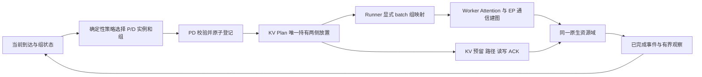

# 实现映射与开发顺序

状态：已有 Qwen profile 冻结、本地基线、跨模块源码快照、隔离案例评测及宿主指标核验。`candidate.py` 开放 Rust/Python 实现区、保护固定事实；`submit.py --scope` 预览影响与义务；`contract.py` 绑定结构化 plan、封存证据和对照；`runner.py` 选择冻结检查与资源 fixture，执行新增测试。全案例的匹配对照和重放形成 `review-candidates.json`，不是正确性晋级。操作见 [SEARCH.md](SEARCH.md)，契约见 [CROSS_MODULE.md](CROSS_MODULE.md)。本轮仅静态与 mock 检查，未运行真实 Docker、构建、仿真或搜索；严格 oracle 和全语义 `VERIFIED` 未实现。下文保留机制开发顺序；持久 Attention 放置等具体机制仍待 agent 实现，不因源码权限已开放而视为已支持。

检查日期：2026-11-23。HEAD 为 `23ae21f81e9431f803c9468dd6c78f5d98d24d7b`，工作树有大量已存在修改与新文件；HEAD 不能单独标识当前实现。实际研究必须冻结工作树内容，不得重置为 HEAD 后声称复现当前基线。

## 1. 当前事实与证据

路径均相对于仓库根目录。证据分为源码/测试定义与既有执行产物：有测试不等于本轮执行过，也不等于所有组合均已通过。

### 1.1 已实现且有对应证据

| 能力 | 代码位置与实际边界 | 已有证据 |
|---|---|---|
| Qwen shared 建图 | `scripts/rooflang_bridge/qwen3.py::QwenTemplate.export`；固定 235B-A22B 元数据来自 `crates/simthesizer-core/src/models/qwen3_235b_a22b.toml`；94 层、128 专家、每 token 选 8 个。Attention TP 为 1/2/4，EP 为 1/2/4/8，TP 整除 EP，expert TP=1、PP=1 | `tests/test_qwen3_ep.py` 的 layout、head coverage、计算守恒测试；`tests/test_qwen3_shared.py` 的 native 集成；最近完整运行证据见下文 |
| 一副本多 Attention 组 | `QwenTemplate.export` 把请求分到 EP/TP 个组，组内 TP，组间共享一套专家；每副本一个同步 scheduler，实例之间是完整模型副本 | `test_tp2_ep8_two_replicas_use_32_gpus_and_all_attention_groups`；不能据此称每组有独立异步调度器 |
| 确定性模型路由 | `token_experts` 用 seed、request ID、token position、layer 生成八个不同专家，批次重排、分块不改变选择 | `tests/test_qwen3_routing_exact.py`；`test_routing_is_batch_order_and_chunk_invariant_with_distinct_top8`；已有 7,312 个身份样例、72 个完整图等价记录 |
| 分开计价的 Attention、专家与通信 | `QwenTemplate._attention`、`_Round.compute/copy/expert/all_reduce`；leader 路由、按实际专家 token 数计算；dispatch 按目的 rank 去重，owner 加权归约后 combine；本地搬运也计 HBM | `test_projection_expert_and_lm_work_are_conserved_across_tp`、`test_dispatch_deduplicates_rank_and_combines_after_local_reduction`、`test_tp_reduction_charges_arithmetic_memory_and_both_network_directions` |
| P/D、KV 分片与生命周期 | `systems/pd_disaggregation.rs::enroll_request` 建立 `kv::Plan`；`kv.rs::KvRuntime` 持有 ready 区间、源引用、pending/inflight、read gate；`rooflang.rs::attach_attention_kv` 绑定实际子 batch | native `explicit_attention_groups_reshard_all_four_heads_across_unequal_tp`、`deferred_copy_pins_sources_until_all_heads_arrive_and_wakes_only_ready_reads`；Qwen `test_attention_tp_reshards_chunked_kv_without_duplicating_heads`、`test_tp2_handoff_gates_each_shard_and_reports_preserve_results` |
| 共享资源与容量 | `resources.rs::Resources` 统一计算/HBM/有向 fabric、stream、allocation；每个原生节点有独立进度/启动等待；不可变 Work 模板及归一化系数可复用 | native `staggered_sharing_updates_both_finish_times`、`slow_copy_does_not_reserve_half_of_hbm_bandwidth`、`shared_work_keeps_progress_setup_and_rates_per_node` 等；最近 220 项 workspace 测试记录 |
| 可替换服务策略 | `policies/mod.rs::PolicyRuntime` 的 route、batch、kv 回调；`RouteAction` 选 P/D 实例，`BatchAction` 选请求/q_len 或等待，`KvAction` 控制已有 KV intent 的提交顺序；`single_instance.rs` 创建逻辑唤醒 | `pd_policy_routes_at_arrival_using_current_load_and_not_future_requests`、`policy_wait_wakes_without_arrivals_and_arrivals_cannot_bypass_it`、`malformed_batches_are_rejected_before_commit`；`output/serving-policy-validation/implementation-checks.md` |
| 轻量策略观察 | `policies/environment.rs::EnvironmentObservation` 按需读取 pressure、memory、registered_reads、ready_tokens；候选状态有字节上限，诊断样本可选且有界 | native `policy_snapshots_do_not_change_resource_execution`、`diagnostic_samples_are_opt_in_bounded_and_do_not_change_actions`；不是全面 MoE 瓶颈诊断接口 |
| 完整结果与 SLO 指标 | `scripts/results.py::validate_complete/slo_metrics`；逐请求联合 TTFT/平均 TPOT 达标，统计通过请求的输出 token/s/GPU；单输出 TPOT 不适用，零输出另处理 | 既有 `agents/find_pareto_frontier` 评测与复验实现；新机制必须继续用冻结的可信分析副本 |
| 旧运行与研究基础 | `find_pareto_frontier` 的 `launcher.py::prepare/local_baseline/docker_arguments/supervise`、`baseline_store.py::seal/validate`、`evaluate.py::Experiment`、`archive.py::pareto`、`verify.py::replay_candidate` | 旧入口保留纯策略边界；新 Qwen 控制器复用其冻结、基线和指标能力，另提供跨模块快照、隔离执行、结构化 plan 及可信检查，不在宿主运行任意候选代码 |

最近运行依据：[round3 验证报告](../../output/runtime-optimization-round3-20261123/validation-report.md) 与 [独立文件核对](../../output/runtime-optimization-round3-20261123/final-verification.json)。其中原 100 请求含 21,027 输入、23,339 输出 token，516.252130 秒主机墙钟、12.99673745093741 秒虚拟完成时间；结果 SHA256 为 `59166135b06d4a17ad12f0482e06aaed5bad6df9cba8773399076a151f5aa4b1`。这是仿真器加速的等价证据，不是新调度机制收益、真实 GPU 校准或未来搜索预算。不同机器/负载不能直接套用该墙钟。

### 1.2 已实现但组合验证不足

- Qwen TP/EP、P/D 不等 TP、whole/layer、报告开关已有代表案例；不等于候选策略 × 多副本 × 跨节点拓扑 × 显存临界值 × 所有合法 layout 的笛卡尔积全部覆盖。新协议只能申报实际通过的组合。
- 策略执行器接受 shared Rooflang，`Experiment.validate_scenario` 并未只允许 Llama；现有实验配置与大量评测证据却主要来自 Llama。必须增加 Qwen 本地基线、候选、恢复、跨机制归档与外部复验的闭环案例，不能只换模型名就称可用。
- `--allow-gpu-sharing` 和异型硬件拓扑已有通用实现/测试；Qwen 动态组放置、EP 通信、KV 延迟发送在这些组合中的容量与竞争仍需专门验证。
- Qwen 候选隔离执行、宿主独占评分及冻结检查已接入；真实 Docker/构建/仿真组合尚未执行。不可见 holdout、严格 oracle 与独立验证 agent 尚未实现；协作审查不能替代独立语义验证。
- 本轮没有新的 GPU 实测、真实 Qwen 路由回放、不可见 holdout 或自主机制研究结果；这些缺口不能用模拟结果相同来填补。

### 1.3 硬编码或现有策略不能控制的决策

| 决策 | 当前实现 | 缺少的表达 |
|---|---|---|
| 请求到 Attention 组 | Python `route`、`QwenTemplate.export`，Rust `RooflangRunner::validate_qwen_batch` 与 `KvTopology::request_devices` 各自重算 `request_id % group_count` | 持久 P/D 组放置动作及唯一状态源；仅修改一处会造成计算与 KV 不一致 |
| 专家归属 | `expert // (E // ep)` 连续分配，权重常驻各 rank | 专家位置表、复制/迁移状态及其成本；改变模型的 top-8 不属于合法替代 |
| MoE 依赖与顺序 | 每层 `router_complete → dispatch_complete → experts → combine_complete → complete`；专家按 ID 枚举，各 GPU 使用固定 stream | 已就绪专家独立推进、专家排序/聚合、传输分块/窗口、真实局部依赖与缓冲区生命周期 |
| batch 边界 | `ChunkedPrefillScheduler` 可显式选请求，但单个副本只运行一个同步 batch，全部算子结束才提交 token | 异步组调度、跨 batch 流水需新机制；不能只去掉 running 检查 |
| EP 通信控制 | `KvAction` 只控制 KvRuntime 已生成的 KV intent；Qwen dispatch/combine 已在 Python 图中按固定顺序建立 | 不能把现有 submit_kv 宣称为通用网络调度；需因果可见的 EP intent 与可执行动作 |
| KV 容量与复用 | 原子预留 prompt P KV 与最大 D context；密集区间，shared 模式拒绝 prefix caching | 动态增长、paging/fragmentation、KV 缓存/迁移需独立成本与守恒验证 |
| 资源分配 | `Resources::admit/rates` 固定容量检查与 progressive filling | 策略无带宽权重/优先级接口；改变 solver 不得冒充实际网络 QoS |

### 1.4 成本假设、观测盲区与校准缺口

- Qwen 是 BF16 存储、既有 FP16 等效分析速率；没有随仓库提供的 235B Qwen kernel profile。FLOPs/读写字节守恒能证明内部一致，不能证明 H200 上的实际延迟。
- 网络是路径带宽与启动项，非 packet/NCCL 实现；本地/远端 HBM、dispatch 8448 字节及 combine 8192 字节的约定来自当前图。真实 packing、top-k、grouped GEMM、融合效率需独立校准。
- Qwen workspace 是同步层复用的保守 arena。流水重叠后旧峰值公式未必成立，必须按 buffer 产生、消费、释放重算；容量计费不能只改图边。
- 核函数启动、主机调度/tokenization、碎片等当前没有完整建模。新增机制必须声明启动、同步、队列控制成本；缺乏测量时用明确的假设/敏感性区间，不能用无成本调度收益宣称现实收益。更改基础成本假设必须新建契约或统一重评。
- D 预留使用已知输出长度 `input + output - 1`；策略未直接取得输出长度，聚合 allocated capacity 仍受此先验影响。这是冻结的 `known_trace` 假设，不是完全未知长度的在线服务。不得再暴露逐请求真实剩余输出或未来请求。
- `ResourcePressure` 是剩余满速服务秒，不是 GPU 利用率；`KvReadRequirement` 是已展开批次登记的未满足读取，不是当前关键路径。并行阶段墙钟/服务需求不能直接相加解释 TTFT。
- metrics-only 会省略大量 operator name/expert metadata；已有 route_summary 主要在 details 中。低开销诊断需要有限维度标签和事件累计，不能要求每次搜索导出全量 trace。
- Python 建整轮图时已经计算后续层 routing；这只是执行计划信息。运行时策略必须在对应 router/top-k 原生事件完成后才获得该层已知路由统计，不能读取完整 worker 响应或提前扫描计划。

### 1.5 文档与代码的范围差异

| 文档位置 | 与代码的差异或容易误读之处 | 本设计采用的依据 |
|---|---|---|
| `ARCHITECTURE.md` 的「Routing runs at the simulated arrival」 | 对 PD 无 policy 分支过宽：`add_request_arrival` 直接 `enroll_request` 做静态轮转；有 policy_runtime 才插入 `RequestArrival` 事件 | 新动态组放置必须进入真实 arrival 分支；旧静态路径保留回归比较 |
| `ARCHITECTURE.md` 开头 profiled cost 描述、`architectures/execution.md` 的 Block Fast-Forward | 不能概括 Qwen shared：它用分析成本且每轮展开全部 94 层 | `qwen3.py::export` 与 `rooflang.rs::add_shared_iteration`；不把旧 profile MoE fast-forward/每 rank scheduler 当作 shared 能力 |
| `agents/find_pareto_frontier/IMPLEMENTATION.md` 的「实现前映射」及 D1–D3 | 表中没有动态 arrival、任意 batch、KV gate、SLO 的描述是历史状态；文件本身提示保留旧映射 | 当前 `policies`、`schedule_batch`、KV gate 与 `results.slo_metrics` 已实现，不重复开发 |
| `run_qwen3_235b_shared_workload.sh` 开头写随机 10 条 | 当前启用 `WORKLOAD=examples/workloads/realistic.jsonl`，10 条赋值被注释 | 以实际配置和冻结 workload 哈希为准，不以注释判定请求数 |
| `agents/find_pareto_frontier/experiment.toml` 的 search 注释 | 注释写累计 2 小时、单次 10 分钟；实际分别为 86400 秒、1800 秒 | 未来配置校验与预算账本使用实际值，不复制旧注释作为授权额度 |

以上仅登记；本轮不修改已有文档与脚本。`architectures/rooflang-shared.md` 的 Qwen 边界与当前代码基本一致；不将不同执行路径的差异强行列为缺陷。

## 2. 开发映射：谁持有状态，谁产生费用

### 2.1 第一机制：持久请求到 Attention 组放置

选择此机制是因为控制缺口明确、改变范围较小且有直接可证伪案例，不意味着已证明当前真实负载的主瓶颈就是 Attention 组。先测证据：若现有 batch/实例策略足以解决压力，保留其结果；无组不均衡证据时不把这项扩展排成已获得收益的方案。

建议扩展现有 `kv::Plan` 的放置信息，而非另建 policy-owned map。计划内分别持有 `prefill_placement` 与可选 `decode_placement`，每项唯一记录实例/组身份；物理设备从冻结 topology 解析。现有 `source/target/routes` 应改为从这些记录派生的只读计划/访问器，不能继续维护另一套可独立修改的组选择。需要保存的路径缓存只由该 plan 生成，创建后不可变。

| 触发 | 权威状态/生命周期 | 集成点与依赖 | 必须保留的约束 |
|---|---|---|---|
| 实际请求 arrival | PD 收到动作，验证 P/D 实例与组；由 KvRuntime 一次性登记两侧放置。D 无输出工作时不存在 D 放置 | `RouteObservation/RouteAction` 扩展为组级观察/选择；`PdDisaggregationSystem::enroll_request`；首版采用一次决定、生命周期固定 | 不按预载 workload 顺序使用未来负载；实例与组容量/拓扑合法；参考动作回到原 modulo |
| 计划提交 | KvRuntime 持有请求 Plan；placement 先于 P 第一个 batch 与容量预留 | `KvTopology::request_devices/slices` 接受已选 placement，不再接收 ID 自行选组；失败须不遗留 plan、decode_reserved 或占用 | P/D 原子建立或整体失败；未知/重复组、跨副本设备、头分片遗漏立即拒绝 |
| 构建本轮 | runner 读取 plan，按 batch 的 request ID 导出当前 stage 的组 ID；worker 只消费显式数组 | `RooflangRunner::validate_qwen_batch/add_shared_iteration`、worker graph 协议、`QwenTemplate.export/route` | batch 重排不能串号；Python 不再独立取模；协议显式版本化，缺字段不能静默回退掩盖错误 |
| 执行 Attention/通信 | 请求所在组决定 QKV/attention/leader、dispatch 源和 combine 返回位置；专家选择不变 | `_attention`、`_Round.copy`，native `attach_attention_kv` | 组本地 KV rank→物理 rank 映射一致；top-8 和专家权重工作量保持模型语义 |
| KV 生产/交接/读取 | 原 plan 驱动源、目标、head slice、路径、ready gate、P/D 容量 | `KvRuntime::reservations/copy/apply`；沿现有 ACK/pin/release 链 | 改放置必须改变实际费用与准入，不能只更新报告标签；容量不足等待正确 release |
| 请求完成/失败 | P-only 在 PrefillDone 完结；D 在 DecodeDone 及 pending/refs 清空后释放 | 复用现有 KV drain；PD pending 通过 plan 查询身份，避免复制可变 placement | 首版不迁移；不能在未发送 KV/未 ACK 时重置组。异常退出记失败，不写成功分数 |

新动作接口的具体类型名由实现定稿，不新增逐事件 Python/LLM 调用。新增放置元数据随现有一次 graph IPC 传输；运行时决策仍是确定性 Rust。原 modulo 是机制关闭及参考模式，不再到处复制公式。

### 2.2 原生观察扩展

先复用现有资源/KV 数据，不为每次查询扫描历史。按实例/组/rank、层阶段和资源类型保存计数、累计量、最大值及有界直方图；详细 token/专家样本按数量/字节预算采样。维度与释放策略随机制版本冻结。

| 诊断 | 所有者/新增时机 | 证据含义及排除项 |
|---|---|---|
| 排队与组压力 | Scheduler 在 enqueue/selection/commit 更新 waiting tokens、queue age、已提交进度；按 plan 归组 | 排除副本级路由偏斜、prompt 长度差和 KV 容量阻塞；请求数均衡不等于工作均衡 |
| 专家不均衡 | Python 计划保留 compact 的 token/expert 工作标签；在对应 router/top-k 完成后才发布可见计数，专家完成再累计服务 | 区分已知路由偏斜与通信未到达；均匀种子下也有抽样差异；合成热点不是真实分布 |
| dispatch/combine 与链路 | `_Round.copy` 提供阶段标签；资源域按 admitted/setup/service/completion 事件累计 bytes、等待、服务 | 区分启动等待、HBM 瓶颈、同 fabric EP/KV 竞争；不得把网络需求秒直接叫网络耗时 |
| 同步等待 | engine 记录预选 barrier 的各前驱完成时刻与释放时刻；只对目标层/轮次保留样本 | 显示可早就绪子集；还需反例/消融证明去同步有益，barrier 等待不是可无条件删除的延迟 |
| HBM/容量 | Resources 维护 allocation 峰值、准入拒绝原因、活动服务积分；buffer 生命周期必须原生登记 | 区分带宽与空间不足；服务积分需定义分母，未校准前不叫实际 GPU 利用率 |
| P/D KV | KvRuntime 在 intent、send、ACK、read gate 创建/满足更新计数与时间；报告 active layer 的受阻条件 | 未到本层的 gate 不算当前 stall；只有等待依赖实际限制执行且被消融改变，才形成关键路径证据 |

报告总量与重叠边界：队列时延、执行 makespan、关键路径、资源服务需求各自保留单位与定义；并发阶段画区间/重叠，不累加成端到端。观察开/关需逐 token 等价并测主机额外时间/RSS；默认低开销，失败定向 trace，不能重新引入每轮独占预演。

### 2.3 路由输入与因果可见性

现有默认是可复现均匀 top-8；`export(routing=...)` 只是单轮诊断入口，当前同一显式 token 列表在各层使用，不能当成完整真实路由回放。

拟新增冻结路由输入适配器：键为 `(request_id, token_position, layer)`，值为有序八个互异 expert ID；均匀、人工偏斜诊断、真实回放分别标注来源、版本与缺失规则。禁止候选改变选择、丢 expert、换 seed 获利。权重/概率若影响所研究机制，应扩展冻结输入和合法算式，不随意补常数。

可信 driver/oracle 可预知计划以便仿真，候选 worker 与策略只能看到已揭示事件历史。隔离层不把整个路由文件传给候选进程；读 API 仅在对应 router/top-k 完成后发布已知 token 的路由。相同已见历史、不同隐藏未来层路由/未来到达/未公开输出长度的成对案例，分叉前动作必须一致。候选不得以 ID/种子重算未来 top-8；确定性不等于因果合法。

现有公开 seed=0、完整 trace 和 baseline 已被开发者/agent 阅读，既不能证明策略没有预知未来，也不能事后命名为 holdout。新建盲 oracle 案例时，路由原文与真实剩余输出只由可信 driver/oracle 持有，不进入候选 worker；在 known_trace 预留可能改变可见容量的案例中，要控制前缀可见状态相同，分别检验假设允许的信息与额外泄漏。新增测试案例/路由输入后，A–E 在同一新身份下统一评测，旧公开证据仅用于训练/回归。

## 3. 工程复用与必须新增的边界

| 分类 | 复用位置 | 本系统需要的变化 |
|---|---|---|
| 直接复用算法/语义 | `results.py::validate_complete/slo_metrics/physical_gpu_count`；`archive.py::objectives/dominates` | 可信副本从自身冻结路径导入；机制 ID 加入候选身份，公平分组按契约/案例，不能因机制不同而禁止同契约比较 |
| 提取共享库并薄封装 | `launcher.py` 的快照、环境/镜像身份、时间目录、本地基线、监督退出；`baseline_store.py` 的完整性验证 | 保持旧 Llama CLI/行为兼容；Qwen 启动层传机制清单/可写范围，不能复制整套 launcher 再各自修补 |
| 扩展候选冻结/构建 | `Experiment.freeze_candidate/build` 现在只允许 `policies/candidate/*.rs` | 冻结机制 patch 与策略源码；按实际 tree/hash 构建，包含 worker Python、原生图/KV/资源相关文件；核心可在隔离副本修改，评测副本不可改 |
| 必须新增可信执行边界 | 当前容器整个 artifacts 可写，宿主 verify 负责之后复验 | 监督程序拥有预算/构建/评分/晋级/归档；不可信编译与候选运行无权写 trusted receipts、基线、holdout 或评分器。具体用户、挂载、网络见 LAUNCHER |
| 扩展验证工具 | 现有 native guards、完整性检查、宿主 clean rebuild | 候选可改 core，不能仅相信它自己的 guard 或上报 JSON。可信独立检查器验证执行证据、依赖/工作量/成本规则；能力不足则补独立审查与反例，未获验证的机制停留探索状态 |
| 扩展身份/复验 | `baseline_store::trial_identity`、`verify.py::replay_candidate` | 绑定物理/评分契约、机制、策略、路由、成本与环境；A 可复用 matching old baseline，C 必须跑新机制参考策略；修正漏计费要统一重评受影响结果 |

现有正则检查 policy 源码不是任意候选安全沙箱；机制修改也不能靠 `AGENTS.md` 宣告可信。候选可以实现/补测试，不能替换可信检查、写 VERIFIED，不能通过候选路径 shadow import 评分模块。

## 4. 分阶段实施与晋级门槛

本节是未来实现顺序，不是本轮运行计划。每阶段都保存失败与未验证范围；机制数量不计成绩。

| 阶段 | 开发产物 | 进入下一阶段的条件 |
|---|---|---|
| D0 契约与隔离执行骨架 | 复用工程能力，加入机制/策略双身份、可信写入者、失败预算和恢复；冻结小案例、当前 Qwen 基线、SLO 与成本边界 | 固定候选能从本地基线→Docker 身份校验→完整小案例→可信评分→独立复验→归档；越界修改/伪造回执/逃逸预算反例被拒绝。先不依赖 LLM 找到收益 |
| D1 有界诊断与假设 | 组/专家/阶段资源观察、瓶颈记录；冻结均匀及偏斜诊断源，路由可见性测试 | 观察开关结果等价；全长小案例测墙钟/RSS/存储后确定搜索规模。主要压力与替代解释均有证据，不能只按服务秒排序 |
| D2 首个自主机制开发 | 研究 agent 从不含组放置接口的冻结父版本出发，自主贯通 policy→plan→worker→KV/通信；可信侧预先提供验证义务和反例，不把新接口由人工补完后交给 agent 调参 | 下表 V1–V8、机制关闭回归通过；以完整小案例建立对照。无收益时可淘汰机制，不能扩大硬件或删请求救分数 |
| D3 完整闭环晋级 | 将 D2 实际代码开发、失败修复和提交记录接入全负载 A/B/C/D/E、监督评分、消融与独立复验 | 至少一个由缺失接口驱动的真实源码扩展得到完整结论；记录机制/策略收益，交互项须按 DESIGN 的固定策略 2×2 对照；不以提案或参数搜索替代 |
| D4 有证据再扩展 | 局部就绪专家、分块通信/窗口、EP/KV 协调、流水/聚合、专家位置与缓存等 | 每项单独满足依赖、缓冲区、字节、计算、驻留、同步守恒；无法校准的部分标探索假设；达到停止条件就归档，不堆叠未解释机制 |

机制晋级过程与角色权限详见 DESIGN/LAUNCHER；本文件的验收案例由可信验证者执行，agent 只能提交补充测试。既有可信检查持续执行，不能因新机制改变节点形状就整批关闭。节点数/顺序可合法改变时应新增语义检查，并保留机制关闭的严格回归。

### 首批可区分案例

以下是诊断构造，不是生产硬件/SLO 参数。使用完整请求，不能截断输出取得「完成」分数。

| ID | 构造与预期 | 能识别的错误/收益来源 |
|---|---|---|
| V1 组碰撞 | 同一副本两组，两个长 prompt 请求 ID 对组数同余；第三请求制造 batch 重排。参考都在同组，合法候选拆组；检查实际 Attention rank、dispatch source、KV source/target | 只改报告/策略标签，或 Python 仍取模；不预先保证端到端必提升，网络增加可抵消计算收益 |
| V2 P/D 独立放置 | P 两组、D 不同组数/TP；显式选非 modulo 的两侧组，分块 P、多个 decode 轮次 | P/D 错用同一组号、KV 头漏/重分片、批次变动漂移；每 token 每层四 KV 头完整且仅一份逻辑拥有 |
| V3 生命周期 | 首次 P chunk 后策略偏好变化；延迟 KV 提交，源未 ACK；D 完成后再到达复用容量的请求 | 首版不能迁移；排队/发送/ACK 期间放置不变，不能早释放，完成后不泄漏 placement/refs/allocation |
| V4 容量临界 | 两组算力近似但某目标组已有 KV 占用，合法组可放、另组不可放；另有所有组暂时不满足的案例 | 容量感知真正改变准入；不得改变权重/容量常数、偷偷超配或删除请求；永久不可能应失败 |
| V5 因果分叉 | 两 workload 前缀相同、未来到达不同；两路由源当前已知一致、后续层不同 | 分叉前路由/组/提交决策一致；禁止按 request ID/种子预见未来专家，也禁止读取未公开 holdout |
| V6 开关回归 | 新机制 reference/modulo 关闭；同 frozen workload/seed，含 reordered batch、whole/layer、单输出、同刻到达 | 与当前实现逐 token 等价；reports/compact rows 不改结果；单输出不应创建 D KV/传输 |
| V7 成本归因 | 固定 top-8，改变组放置；分别使用对称和跨慢链路拓扑；保持请求完整 | 专家任务总量相同、网络字节按真实新源/目标重算，额外 HBM/路径计费；区分合法路径缩短与并行改善的贡献，拒绝漏算搬运的假收益 |
| V8 评测反例 | 删一个 expert、跨依赖提前读、少生成 token、伪造统计、修改 trusted 文件、临时改源码再还原、恢复错误身份 | 可信验证/监督器拒绝；候选自己的 check_drained 或「结果完成」不足以放行机制 |

完成以上小案例后，按冻结训练/可见验证/隐藏 holdout 协议运行全负载：A 当前 Qwen；B 旧机制优化策略；C 新机制参考策略；D 新机制优化策略；E 去掉关键放置规则或观察的消融。比较 C−A、B−A、D−C 和 D−B，并保留不同延迟—吞吐取舍；A/C 参考模式语义不同必须说明。独立搜索后的 B/D 不能单独识别交互，需另做 DESIGN 规定的兼容固定策略 2×2 对照。失败尝试、诊断、开发、构建和复验同计研究预算。

## 5. 残余瓶颈如何触发后续开发

| 原生证据与需排除解释 | 下一候选及前置条件 |
|---|---|
| 同副本各 Attention 组服务/队列明显失衡；排除请求长度与副本路由 | 先持久组放置，再负载/KV locality 联合选择；收益不足则不做迁移 |
| 多个专家输入已经到达却在等待无关 dispatch；排除 stream 占用、HBM/容量不足 | 细化专家输入依赖，保留每 token top-8 完整执行；局部就绪与有限 buffer 测试先行，不能直接删 barrier |
| dispatch/combine 启动/链路等待主导，且聚合/拆分成本有依据 | 有界聚合、分块与发送窗口；计每块启动、pack/unpack、HBM、暂存容量，避免把大包直接拆成免费并发 |
| EP 与 KV 使用同一 fabric，重叠时出现真实 active read stall | 通信提交协调；先把 EP intent 暴露为因果动作，禁止把 registered_reads 总数当紧急度真值 |
| 层间/阶段间同步空隙可被独立工作填充，容量有余量 | 通信计算流水；先建立 buffer 双重驻留/引用与释放，再改跨层/跨 batch 依赖 |
| 相同真实/诊断路由下专家负载集中且不是输入未就绪 | 专家任务顺序/有界聚合优先；静态重放仍不足才考虑专家位置、复制/迁移，增加权重传输、常驻/临时内存、同步与一致性 |
| 计算/HBM 近满、去等待收益很小，或分析模型对融合假设极敏感 | 先补可信硬件成本/敏感性证据；不再堆调度机制。无校准的结果保留探索等级 |

最终开发验收：在现有接口不足时，agent 能提交实现新状态/动作/依赖的源码，经独立检查和完整评测获得可信结论，并从失败或剩余压力提出下一需求；仅输出「建议人工添加接口」或多跑一轮调参均不算完成。
