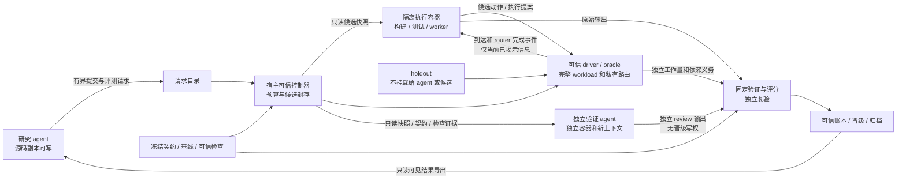

# Qwen MoE 启动与隔离设计

**状态：已有探索性运行入口，见 [SEARCH.md](SEARCH.md)。** `run_qwen_moe_agent.sh`、本地基线、冻结控制器、研究/执行容器入口及源码提交评测已经实现；仅做静态与 mock 检查，尚未真实启动 Docker、构建、仿真或搜索。下文保留长期隔离设计，跨 run 基线导入、严格 oracle、独立验证 agent 和全语义 `VERIFIED` 晋级仍是后续目标，不代表当前保证。实际权限与结果状态以 `control.py`、`candidate.py`、`runner.py` 和 [SEARCH_TASK.md](SEARCH_TASK.md) 为准。

当前跨模块链路：开放候选 Rust/Python 实现区 → `--scope` 推导实际影响与检查义务 → `--plan` 绑定假设、状态 owner、测试及封存证据 → 无凭据容器运行冻结检查/新增测试和完整案例 → 宿主重算指标 → 对照/重放/全矩阵汇总为待审清单。保护的是模型、物理事实、基础定价、输入、评分、可信工具和依赖，不是预先穷举的优化名称。control 的参考复现不能自动证明后来候选的同源关闭路径等价，结果仍为 `EXPLORATORY`。

本次 Qwen 文件改动不增加共用镜像构建输入，已有匹配镜像可复用；新权限须新建 run。`--resume` 保留原 run 冻结的实现与范围，不随宿主源码升级。

## 现有实现与复用边界

以下路径均相对项目根目录；本表记录旧基础设施与长期演进，当前已接入能力以首段及 SEARCH.md 为准。

| 现有代码及符号 | 可复用内容 | 新系统处理 |
|---|---|---|
| `agents/find_pareto_frontier/run-agent.sh`；`run_rooflang_agent.sh` | 项目定位、Python 选择、参数数组、构建与运行分离 | 新入口薄封装；不修改现有 Llama 入口的默认行为 |
| `agents/find_pareto_frontier/Dockerfile` | 固定 Python/Rust/uv/Codex；显式安装 Codex 平台包；排除 vLLM；离线 Cargo 缓存 | 复用环境配方，区分 agent 与无凭据执行入口；镜像 ID 纳入身份 |
| `launcher.py::{build_identity,project_builder,build_image,image_identity}` | 最小无凭据构建上下文、项目 builder、host 构建网络、代理失败回退、镜像身份检查 | 提取公共能力，保留原入口兼容；增加构建资源所有权和租约清理 |
| `launcher.py::{source_files,inventory,prepare,load_bundle}` | 正向源码清单、排除凭据/产物、拒绝符号链接、时间目录、输入哈希和恢复校验 | 冻结改为“可信契约 + 参考源码 + 可变候选”；现有 `AGENT_REL`、`POLICY_REL` 和允许的 run 根目录写死，须参数化 |
| `baseline_store.py::{seal,validate,result_environment}`；`evaluate.py::Experiment.prepare_baseline` | 本地完整基线、原子封存、逐文件哈希、环境兼容和基线预算 | 复用封存方式；新增独立于 run 时间/路径的基线身份，支持显式跨 run 导入 |
| `entrypoint.sh`；`launcher.py::enter_container` | 挂载检查、独立缓存、环境预检、固定 CLI/model 后启动 agent | 薄包装 agent 入口；将权威评测移出 agent 进程和可写目录 |
| `evaluate.py::Experiment.{freeze_candidate,build,evaluate,accounting}` | 候选快照、构建身份、完整结果校验、指标图、超时和失败记录 | 复用流程与纯函数；候选需支持 Rust/Python 机制补丁，不能沿用“仅纯 Rust 策略”的提交边界 |
| `search_plan.py::{checked_records,completed_evidence}`；`archive.py::{pareto,update_archive}` | 证据复核、完整性、按比较组计算 Pareto | 权威账本由宿主控制器写；agent 只读导出。跨机制的比较组须按冻结契约划分 |
| `verify.py::{verify,replay_candidate}` | 容器外干净重建、完整重放、结果匹配、独立复验预算 | 保留独立复验思想；改为隔离执行候选，扩展机制验证，不能在宿主直接运行任意 core 补丁 |
| `launcher.py::{docker_arguments,supervise,stop_container}`；`evaluate.py::run_process` | rootfs 只读、非 root、资源限制、独占 run 锁、按容器 ID/进程组退出 | 复用监督方式；覆盖 agent、候选构建、评测、复验全部作业 |

表中未写完整目录的 Python 文件均位于 `agents/find_pareto_frontier/`。后续提取公共库应以旧入口回归检查为前提，不复制第二套冻结、指标和 Pareto 实现。

旧策略入口存在以下边界。新 Qwen 入口已用源码快照、宿主账本、隔离执行和固定检查扩展前四项，但尚不能证明任意新机制的全部语义；第 5 项严格信息隔离仍未实现：

1. `launcher.py::docker_arguments` 只开放 `policies/candidate`；`evaluate.py::Experiment.freeze_candidate` 仅接受该目录下的纯策略 Rust 文件，无法提交建图、worker、KV 或资源生命周期机制。
2. `baseline_store.py::trial_identity` 把整份参考 `source_sha256` 放入比较组。机制源码变化后不能直接按原组比较；需分开冻结契约身份、机制身份和策略身份。
3. `evaluate.py` 的账本、结果和构建缓存在 agent 可写 `artifacts/cache` 内。现有源码只读和外部 `verified/` 有效隔离部分写权限，但普通 `VALID_*` 结果仍是 provisional；不能把它们当成防篡改晋级凭据。
4. `verify.py` 可检查干净重放一致，却不能证明候选自报的成本和依赖正确；`--policy-capabilities` 同样只是候选程序声明。放开 core 后必须补独立机制检查，不能只扩大可写挂载。
5. `crates/simthesizer-cli/src/main.rs::{main,load_workload}` 在创建 Engine 前载入完整 workload；`scripts/rooflang_worker.py::main` 的 `graph` 分支一次返回整轮图。候选可改这些代码时，只读挂载并不能防止读取未来请求或路由，必须扩展可信事件 driver/oracle 与候选 worker 的信息边界。

## 启动接口与后续设计

根脚本 `run_qwen_moe_agent.sh` 与目录内 `run-agent.sh` 已接入。Shell 只负责选解释器和传递 argv；配置解析、冻结、权限与预算由固定 Python 控制器负责。下表除跨 run 的 `--reuse-baseline` 外均有当前入口；后者仍是设计，不能执行。

| 模式 | 行为 |
|---|---|
| `--check --experiment FILE` | 只做静态配置/路径检查，报告未实现能力；不编译、不启动 Docker/API |
| `--build-only` | 仅构建环境；不读取实验凭据、不运行基线或 agent |
| `--prepare-only --experiment FILE` | 新建时间目录，冻结契约、参考源码和声明输入；不执行仿真 |
| `--baseline-only --experiment FILE` | 新建 run，在本地以可信参考源码完成基线并封存；不调用 Docker/API |
| `--baseline-only --resume RUN` | 在同一 run 继续未完成的基线案例；校验已完成证据，保留预算 |
| `--resume RUN` | 沿用同一 run 的冻结配置、已封存基线、候选和剩余预算，启动/恢复研究 |
| `--reuse-baseline BASELINE --experiment FILE`（未实现） | 计划新建时间目录，验证兼容基线后启动独立研究；当前仅支持同一 run 的 resume |

默认不悄悄重建不匹配镜像，也不悄悄补跑不兼容基线。第一次采用新入口/entrypoint 时需构建匹配镜像；之后仅机制/策略源码变化通过候选快照传入，依赖环境不变时无需每个候选重建镜像。环境、可信控制器或锁文件变化必须生成新身份，不原地修改旧 run。

采用 `runs/YYYYMMDD-HHMMSS[-序号]/`。参数只在实验文件维护，启动脚本不再重复 P/D 型号、数量、并行划分、工作量和 SLO；示例配置未确认的字段必须拒绝运行。付费模型/端点/预算由实验契约指定，不能照搬 Llama 实验的模型和生产参数。

## 本地基线到 Docker

1. 宿主控制器冻结输入、参考机制、参考策略、基础成本、SLO、指标/验证器和依赖身份。原始 workload/路由与派生负载各自保留哈希；不能只按文件名匹配。
2. 本地只执行可信参考代码，完成约定案例矩阵，每条请求生成全部输出。保存结果、指标、指标图、轻量诊断、配置、路由来源、构建与计费证据。完整但不达 SLO 的基线可以封存；不完整结果不能封存。
3. 控制器以临时目录加原子发布封存基线，最后写 anchor。Docker 启动前和入口预检分别验证 anchor、证据、案例矩阵和运行环境；复用失败即拒绝该启动，不偷偷替换基线。
4. agent 只接触可见的封存结果；仅评测新机制/策略。基线完整结果可复用不等于新机制可免测：新机制仍必须完成关闭回归、全量对照、消融及独立复验。

基线兼容键包括冻结契约、参考机制/策略、完整案例矩阵、路由输入/种子、基础成本、评测/验证版本及结果相关环境。路径和创建时间是来源信息，不成为数值兼容依据。环境允许归一化的字段由固定程序白名单处理；候选不得自行忽略差异。

| 变化 | 复用规则 |
|---|---|
| 相同契约下的新策略 | 复用 A 基线；执行新策略完整评测 |
| 相同契约下的新机制 | 保留 A/B 对照；执行 C/D/E 及关闭回归，不能复用旧机制候选结果 |
| 仅新 run 的目录/时间变化 | 可显式导入同一封存基线；新 run、预算和候选历史独立 |
| 工作量、路由语义、硬件、SLO、成本或指标口径变化 | 新比较组；重评受影响 A/B/C/D/E。受保护契约改变需用户授权 |
| 修复漏算成本等模拟器缺陷 | 标记修复版本，重评受影响基线/候选；差值不计作机制收益 |
| 验证器新增可信检查 | 重新验证受影响结果；必要时重跑证据，旧状态不能自动继承 |

跨 run 导入同时记录基线原始研究成本和本 run 的新增成本；同一总研究账本只扣实际执行一次。比较搜索效率时必须说明共同基线的成本归属，不能隐藏首次基线或失败成本。

## 进程和文件权限

权限边界为四个进程域，仅研究、独立验证两个角色使用模型：

- **宿主可信控制器及 driver/oracle**：从冻结可信代码启动；唯一可使用 Docker、接收提交、核算预算、持有完整 workload/私有路由并生成评分/晋级/归档凭据的程序。它不 `import` 候选 Python，不执行候选 shell，不接受任意 Docker 参数。
- **研究 agent 容器**：诊断、设计、实现及协作质疑。可以编辑隔离副本的必要 Rust/Python 机制、策略和新增测试；只能请求构建/评测。这里多个 agent 的互评称为协作审查。
- **候选执行容器**：由控制器按固定模板创建，执行未受信任的编译、测试及机制/策略 worker。正式因果隔离模式不挂载完整案例、私有路由或种子，worker 仅经事件驱动协议获得当前已揭示信息。无 API 凭据、无网络、无 Docker socket；输出全部待核验。
- **独立验证 agent 容器**：新上下文，只读封存快照、契约和允许公开的检查结果；仅可写自己的 `review-output/`，不挂载研究 agent 的可写目录，也无候选或 trusted 写权。输出审查/反例/验证扩展建议，不能直接评分或晋级。新机制和验证扩展才调用该角色，常规策略复用固定检查。

目录为拟议结构，宿主权限与容器 mount 同时落实：

| run 内目录 | 研究 agent | 候选执行容器 | 独立验证 agent | 权威写入者 |
|---|---|---|---|---|
| `task/`、`source-reference/` | 只读公开部分 | 只读必要子集 | 只读公开部分 | 控制器冻结阶段 |
| `inputs/`、私有路由 | 不挂载；训练资料经可见导出提供 | 不挂载；仅接收 driver 事件消息 | 不挂载 | 控制器冻结，driver/oracle 私有读取 |
| `baseline/` | 只读可见子集 | 不挂载 | 只读可见子集 | 控制器；隐藏逐例证据不导出 |
| `candidate/worktree/`、`agent-notes/` | 可写 | 不挂载动态工作树 | 不挂载 | 研究 agent |
| `submissions/` | 可写请求区 | 不挂载 | 不挂载 | 研究 agent 提交，控制器安全读取 |
| `trusted/snapshots/` | 不挂载 | 当前快照只读 | 待审快照只读 | 控制器 |
| `trusted/ledger/`、`trusted/receipts/`、`trusted/verified/` | 不挂载 | 不挂载 | 不挂载 | 控制器及固定验证/评分进程 |
| `results-export/` | 只读 | 不挂载 | 只读 | 控制器从可信结果导出 |
| `review-output/<审查>/` | 不挂载；只读最终导出 | 不挂载 | 仅本次审查可写 | 独立验证 agent；控制器校验封存 |
| `execution/<作业>/` | 不挂载 | 仅本作业 scratch/observations 可写 | 不挂载 | 该作业；控制器封存后检查 |
| `cache/agent/` | 可写本角色子目录 | 不挂载 | 可写独立角色子目录 | 各 agent；不作为可信构建缓存 |
| `cache/build/` | 不挂载 | 按机制/环境隔离 | 不挂载 | 控制器监督；独立复验使用干净缓存 |

研究容器沿用 `--read-only`、`--cap-drop=ALL`、`no-new-privileges`、非 root UID/GID、CPU/内存/PID/tmpfs 限制。不挂宿主项目、home、凭据目录或 Docker socket。只读目录不能靠提示词实现，也不能通过另一个可写父挂载暴露。运行目录属用户私有；同一宿主用户主动修改它不属于容器隔离保证，修改后身份检查必须拒绝复用。

控制器从请求区读取受限 schema，只接受候选 ID、预定义动作和案例 ID；路径规范化、拒绝符号链接/硬链接逃逸、大小/文件数限制、原子复制及复制后哈希均在控制器完成。快照封存后再评测，不边编译边读取 agent 工作树。传给容器的是控制器生成的 argv，不拼 shell 命令。

可信 driver 保有事件时钟和未到达请求；oracle 保有未揭示专家选择。只在合法到达、状态更新及对应 router/top-k 完成事件后发布协议允许的信息，不传整轮图、原始路由种子或未来请求文件。候选提交机制动作/建图提案，可信侧按独立语义检查接纳。冻结契约允许的 `known_trace` 预留信息仍须明确标注；不能只隐藏输出长度字段就宣称没有先验。

现有原生 CLI/整轮 worker 尚无此隔离。过渡阶段运行现有原生候选时，必须标注为“代码审查与相同可见前缀、不同隐藏未来的因果干预所支持的受限验证”，不能宣称强因果隔离或盲 holdout。只有可信 driver/oracle、受限事件协议和原始输入不可访问的权限边界实现并通过反例后，才能启用对应保证；即使如此，也不宣称对任意源码有形式化因果证明。

agent 可修改候选中的 core 机制实现；可信目录保留原始 engine/resources 基础资源/成本语义、冻结路由与独立检查。不得修改可信检查、成本参数或评分器。候选自报 trace、能力声明和测试通过只是证据输入：固定检查须从冻结工作量/路由独立推导请求/token、算子、专家、字节、容量和依赖约束，再核验候选执行证据。不能用同一个候选函数既生成事实又证明事实。

如新机制超出现有检查能力，结果只能进入 **EXPLORATORY**。agent 可提交验证扩展；独立审查配合可信反例/meta-check，通过后由控制器登记新验证版本，旧检查只增不减。协作审查意见不能直接写晋级状态；无需逐轮人工批准，但缺少独立依据的成本假设不能靠“复验一致”晋级。重放证明可重复，不能证明真实 GPU 精度。

holdout 仅由可信 driver/oracle 在候选冻结后使用；原始输入、路由、逐例结果不导出给两个 agent，也不挂载给候选 worker。只按预先冻结的协议发布终局汇总，避免重复反馈变成训练。没有独立 holdout 或尚无上述隔离时在凭据中明确标记，不能沿用“盲 holdout 已验证”的措辞。

## 构建、网络和 entrypoint

镜像构建复用现有最小上下文与项目专用 builder：仅 Dockerfile/入口/工具、manifest/lockfile，不发送 workload、历史结果、源码研究副本或凭据。宿主 Docker daemon、默认 builder 和系统代理不修改；代理仅在本次构建进程生效，网络失败可按明确配置重试并计费。

两个 agent 的网络只用于调用授权模型服务，候选执行网络固定为 `none`，事件消息经控制器持有的受限管道传递。`host` 网络仅在需要访问本地代理且显式选择时沿用；它并不提供网络隔离。API 凭据只注入各 agent 服务进程，绝不进入构建、仿真或固定验证器环境；日志不打印环境文件内容。若要求硬性 API 请求/token/金额上限，使用受控网关和 run 专用额度，agent 网络只允许该网关；普通 host 网络 + 自报 token 日志不具备此保证。网关不可用时不得宣称该硬上限已启用。

研究 agent entrypoint 顺序：挂载/UID检查 → 契约、可见基线及镜像身份检查 → 控制器握手与预算检查 → 固定版本 agent。独立验证入口另检查封存 snapshot、独立上下文和唯一 review 输出权限，不复用研究会话。两者不升级依赖、不执行完整基线。模型运行时的调度动作仍由确定性原生代码执行，不逐事件调用大模型。

构建/评测入口从控制器只读作业单启动：校验快照 → 限时构建/测试 → 连接可信 driver 的事件管道执行 worker → 输出原始结果 → 退出；不能把全 workload 路径直接传给候选。过渡原生模式单独标注受限验证范围。评分在候选已停止后由可信工具读取只读结果；解析限大小、拒绝非有限数、缺字段及不完整请求，不执行输出内的代码。候选新增测试可执行，但不能覆盖固定检查或让执行容器获得评分写权限。

## 恢复、预算和退出

研究运行状态统一采用 DESIGN 的 `ACTIVE/STOPPED/FINISHED`，候选晋级也由该文档的状态机唯一维护。实际容器/作业 ID、退出原因、已消费预算和时间只是监督元数据，不另立权威生命周期。中断、预算耗尽或基础设施故障进入 `STOPPED`；只有满足研究结束条件才进入 `FINISHED`。agent 进程退出不等于研究完成，更不等于候选 VERIFIED。

每项作业先在可信账本预留预算并分配 attempt ID，再创建容器；无预算不得启动。完整案例含构建、仿真、结果校验和绘图，失败、超时、OOM、重试、诊断和独立复验均记账。原有 `Experiment.accounting` 的“started 无 finished 仍收费”规则可复用，账本必须移到 agent 不可写位置。

分别保留三类量：

| 类别 | 记录/约束 |
|---|---|
| 模拟服务 | TTFT/TPOT、达标输出吞吐/GPU、完成率、Pareto；不能与墙钟混用 |
| 仿真器 | 仿真与绘图分别的墙钟、CPU、峰值进程树内存、输出大小；完整案例时限 |
| 研究过程 | API 计费、诊断/设计/实现/构建/失败/评测/复验，累计墙钟、CPU、磁盘和并发上限 |

累计总墙钟用实际活动区间计算；并行作业的各阶段用量另列，不重复相加冒充端到端时间。所有研究消耗进入总预算，局部子预算不能绕开总上限。磁盘要有实际配额或独立空间限额，不能只在文档写上限；现有 launcher 尚无磁盘配额，需要扩展。

恢复取得同一 run 锁后：校验契约/参考源码/镜像/封存证据 → 对照容器 ID 和所属标签回收本 run 遗留作业 → 为中断 attempt 写终止记录并收费 → 从最后已提交状态继续。未提交临时目录不作完成结果；保留供诊断。已完成试验仅在候选、案例、环境、验证版本和证据哈希全部匹配时复用。不能清零预算、改旧 manifest 或把候选自写 receipt 当作恢复依据。

正常结束、SIGINT/SIGTERM、OOM 和预算耗尽：停止本 run agent 和执行作业，超时升级为 kill，按准确 ID 删除所属容器，记录退出原因；失败清理保留 ID，恢复时重试。保留 run、结果、源码快照与明确可复用缓存。不调用全局 prune，不按名字前缀批量停止其他 run，不停止 Docker 服务。

共享 `project_builder` 以项目、UID、daemon 和代理配置生成独立身份，在同一项目锁内启动、构建并于 `finally` 停止该 builder。保留 metadata 和构建缓存，不删除 builder 或停止其他人的容器；创建失败或身份/driver 不符时不猜测所有权。停止失败明确报错，同时保留原构建异常。`--resume` 不隐式启动 builder；跨 run 基线导入仍未实现。

## 上线前验收门槛

本轮仅设计，不执行以下检查；后续实现完成后再开展：

1. 静态配置拒绝未实现字段/缺参数，`--check`、`--prepare-only` 不触发 Docker/API/仿真。
2. 本地基线封存、跨 run 导入和同 run 恢复可区分；身份破坏、残缺基线和错误环境均拒绝。
3. 候选能修改必要 core/worker 机制，却写不到可信工具、账本、基线或 VERIFIED；读不到完整未来输入/私有路由/holdout。独立验证 agent 只有只读快照与独立 review 输出；评分时不从候选路径导入工具。
4. 伪造能力/成本/trace、篡改缓存、请求路径逃逸等反例不能得到可信晋级；机制关闭回归失败会淘汰候选。
5. 超时/OOM/中断/重试完整计费，清理只命中本 run 作业；独立复验采用干净环境且不相信搜索容器的结果。
6. 先用少量**完整请求**完成全链路成本评估，确认预算能覆盖基线、候选、失败和复验后，才扩大搜索；禁止截断输出冒充完整评测。
7. 默认仍保存 `result.jsonl`、`metrics.json`、指标图、轻量诊断和复现身份；全量 trace 只对指定失败/瓶颈案例定向开启。
